# JWT and RBAC Retrieval Flow

Interview-ready walkthrough of how a WebSocket query is authenticated, permission-scoped, retrieved, and returned.

## End-to-end flow

```mermaid
flowchart LR
  classDef client fill:#E8F1FF,stroke:#3973C6,color:#132B4A,stroke-width:1.5px
  classDef auth fill:#F0EAFE,stroke:#7952B3,color:#2A1748,stroke-width:1.5px
  classDef policy fill:#E7F7EE,stroke:#399466,color:#123D29,stroke-width:1.5px
  classDef transport fill:#FFF4DF,stroke:#C88719,color:#513709,stroke-width:1.5px
  classDef retrieval fill:#E5F7F7,stroke:#238A8A,color:#123F42,stroke-width:1.5px
  classDef answer fill:#FCE9EF,stroke:#BC5574,color:#4C1D2D,stroke-width:1.5px
  classDef deny fill:#FFF0F0,stroke:#C94B4B,color:#541B1B,stroke-width:1.5px

  subgraph C[1 · Client and connection]
    A[Postman or UI<br/>WebSocket + Bearer JWT]:::client
    B[main.py · websocket_endpoint<br/>Check Origin; extract Bearer token]:::auth
    A --> B
  end

  subgraph I[2 · Authenticate and authorize]
    V[access_control.py · validate_access_token<br/>Verify signature, issuer, audience, expiry<br/>Extract user ID and JWT roles]:::auth
    P[effective_permissions<br/>Map JWT roles through rbac_roles.yaml<br/>Produce allowed document roles]:::policy
    D{Token valid<br/>and permissions non-empty?}:::policy
    X[Reject handshake<br/>No query reaches retrieval]:::deny
    V --> P --> D
    D -- No --> X
  end
  B --> V

  subgraph G[3 · Protect and transport request]
    S[sign_internal_request<br/>Attach identity, roles, permissions<br/>HMAC-sign the request]:::transport
    K1[Kafka · chat-requests]:::transport
    B2[RequestResponseRouter<br/>verify_internal_request checks signature,<br/>freshness, and policy permissions]:::auth
    D -- Yes --> S --> K1 --> B2
  end

  subgraph R[4 · Permission-filtered retrieval]
    W[RetrievalWorkflow<br/>Route query through retrieval path]:::retrieval
    H[ChunkRetriever<br/>Hybrid retrieval: BM25 + vector search<br/>Both filter allowed_role by permissions]:::retrieval
    Q{Authorized chunks<br/>meet relevance threshold?}:::policy
    Y[Synthesizer<br/>Receives only accepted authorized chunks]:::answer
    F[Fixed role-safe fallback<br/>No sufficiently relevant authorized chunks]:::deny
    B2 --> W --> H --> Q
    Q -- Yes --> Y
    Q -- No --> F
  end

  subgraph O[5 · Return answer]
    K2[Kafka · chat-responses<br/>session_id + connection_id]:::transport
    M[WebSocket consumer / ConnectionManager<br/>Send reply to matching live connection]:::client
    Z[Client receives answer]:::client
    Y --> K2
    F --> K2
    K2 --> M --> Z
  end
```

## The policy has two role layers

`app/configs/rbac_roles.yaml` has two related mappings:

1. **Document role → filenames (`roles_mapping`)**: ingestion uses this to tag a chunk with its `allowed_role`.
2. **JWT user role → permitted document roles (`role_permissions`)**: the WebSocket gateway uses this to resolve what the caller may search.

For example, a JWT role of `retail_banking_staff` resolves to the document role `retail_banking_staff`. Elasticsearch applies that role list to both BM25 and vector search. Unauthorized chunks are excluded before ranking and synthesis.

## Important functions, in two points each

### `app/websocket_service/main.py`

| Function | What it does |
|---|---|
| `startup_event()` | Starts the background Kafka response consumer when FastAPI starts. It does not open a WebSocket client connection. |
| `ConnectionManager.connect()` | Rejects a session ID that is already connected. Accepts the socket and stores the verified principal and a unique connection ID. |
| `ConnectionManager.send()` | Looks up the active session and connection. Sends a response only when its connection ID still matches. |
| `websocket_endpoint()` | Checks Origin and reads a Bearer token or authentication cookie. Validates the JWT, resolves permissions, checks expiry, signs each query, and publishes it to Kafka. |
| `ConnectionManager.disconnect()` | Removes a closed connection from the active-session map. This prevents later replies from targeting a stale socket. |

### `app/security/access_control.py`

| Function | What it does |
|---|---|
| `_jwks_client(url)` | Reuses a JWKS client for the given identity-provider URL. JWKS is the public-key set used to verify provider-issued JWTs. |
| `_jwt_key(token, algorithms)` | Chooses the verification key from JWKS, a public key, or an HMAC secret. Rejects configuration with no compatible key source. |
| `validate_access_token(token)` | Verifies signature, allowed algorithm, issuer, audience, and expiration. Returns only the trusted user ID, roles, and expiry needed by the app. |
| `load_rbac_policy()` | Loads and validates the YAML role mappings. Caches the policy for the process lifetime; restart services after editing the YAML. |
| `effective_permissions(user_roles)` | Maps verified JWT roles to allowed document roles. Unknown roles grant no permissions, so the connection fails closed. |
| `sign_internal_request(...)` | Builds the internal Kafka payload with the query and verified authorization context. Adds an HMAC signature so downstream services can detect tampering. |
| `verify_internal_request(request)` | Checks the HMAC, request age, required fields, and role-policy consistency. Returns the request context only after those checks pass. |
| `memory_scope_id(allowed_roles)` | Hashes the current permission scope and relevant policy settings. Lets memory storage separate conversations with different access scopes. |

### Retrieval and response functions

| Function | What it does |
|---|---|
| `RequestResponseRouter.process_request()` | Verifies the signed Kafka request and extracts the trusted identity and permissions. Passes them into the retrieval workflow and stores memory under the permission scope. |
| `RetrievalWorkflow.route_intent()` | Sends greeting/off-topic intents to the small-talk path. Sends knowledge questions through query refinement and retrieval. |
| `ChunkRetriever.retrieve()` | Runs BM25 and vector retrieval with the same allowed-role filter. Merges and reranks only those authorized candidates. |
| `RetrievalAgent.execute()` | Embeds the query and calls the filtered retriever. Passes chunks onward only when the best relevance score meets the threshold. |
| `SynthesizerAgent.execute()` | Builds its answer from the accepted source chunks and cites filenames. It is downstream of the authorization filter, so it receives only authorized chunks. |
| `SmallTalkAgent.execute()` | Returns the fixed role-safe message when no authorized result is relevant enough. Handles ordinary small talk separately from knowledge retrieval. |

## Interview explanation

> “When a client opens a WebSocket, the gateway validates its JWT and maps the verified roles to document permissions. Each query carries that trusted context through Kafka with an HMAC signature, which the retrieval service verifies. We apply the permission filter directly to both keyword and vector search, so unauthorized chunks never reach synthesis. If no authorized chunks are relevant enough, we return a fixed generic response.”

## Current implementation notes

- The local test-token generator creates role-based tokens for development; it is not a user directory or production identity provider.
- The current policy uses matching names for JWT roles and document roles. If those namespaces diverge later, `effective_permissions()` should validate resolved permissions against document-role keys (`roles_mapping`).
- The BM25 and vector filters are enforced in Elasticsearch queries, not by asking an LLM to infer the caller’s permissions.
